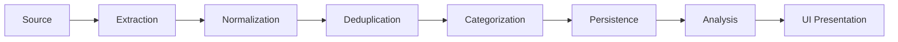
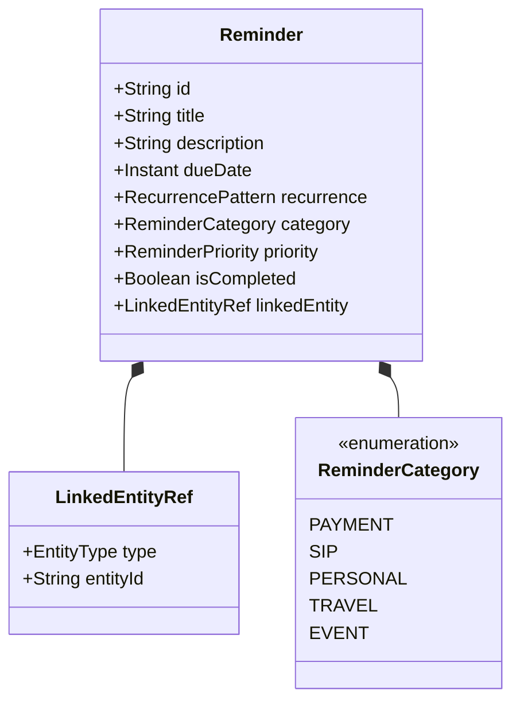

# AnixLifeTracker - System Architecture

## 1. Overview

**AnixLifeTracker** is a personal life-management application built using **Kotlin Multiplatform (KMP)** and **Compose Multiplatform**. It provides automated financial tracking, investment monitoring, upcoming obligation identification, and universal reminder management.

### Target Platforms
- **Android** (Primary initial focus with native SMS/Notification ingestion)
- **Desktop (JVM)** (Windows, macOS, Linux)
- **Web (Kotlin/Wasm)** (Browser-based dashboard)
- **iOS** (Planned future target; architecture isolated via KMP source-sets)

---

## 2. Core Architectural Principles

AnixLifeTracker follows **Clean Architecture**, **MVVM with Unidirectional Data Flow (UDF)**, and **Offline-First** operational principles.

```mermaid
graph TD
    subgraph Presentation Layer
        UI[Compose Multiplatform UI]
        VM[ViewModels / StateHolders]
        State[UI State / Actions]
    end

    subgraph Domain Layer
        UC[Use Cases / Business Logic]
        Models[Domain Models / Monetary Types]
        RepoInterfaces[Repository Contracts]
    end

    subgraph Data Layer
        RepoImpl[Repository Implementations]
        DataSources[Local DB / Remote API Data Sources]
        Mappers[Data Mappers]
    end

    subgraph Platform Layer
        SMS[Android SMS / Notification Readers]
        SecureStore[Platform KeyStore / Credentials]
    end

    UI -->|Dispatches Actions| VM
    VM -->|Exposes State Flow| UI
    VM -->|Invokes| UC
    UC -->|Interacts with| RepoInterfaces
    RepoImpl ..|>|Implements| RepoInterfaces
    RepoImpl --> DataSources
    DataSources --> Mappers
    DataSources --> SMS
    DataSources --> SecureStore
```

### Key Architectural Guidelines
1. **Clean Architecture Boundaries**: Business logic in Domain has zero dependencies on Presentation, Room/SQLite, Android APIs, or UI frameworks.
2. **Unidirectional Data Flow (UDF)**: UI states are exposed as immutable `StateFlow<UiState>`. User interactions dispatch explicit `UserAction` intents.
3. **Repository Pattern**: Abstract contracts reside in the Domain layer; concrete implementations reside in Data and map raw storage models to domain models.
4. **Offline-First Data Access**: All user operations write locally to Room/SQLite database first. Remote synchronization occurs asynchronously in the background.
5. **Exact Financial Precision**: All monetary values are strictly represented using integer-based minor units (e.g., `amountInCents: Long` or custom exact `Money` value types). `Float` and `Double` are strictly prohibited for financial accounting.
6. **Decoupled Ingestion Pipeline**: Ingestion of financial data (SMS, notifications, statement PDFs, CSVs, APIs, manual entry) is strictly separated from transaction processing and core accounting.

---

## 3. Transaction Ingestion Pipeline

Financial transactions arrive from diverse, platform-dependent sources. The architecture standardizes ingestion through a linear 8-stage pipeline:



1. **Source**: Android SMS Listener, Android Notification Listener, Statement Parser (PDF/CSV), Manual Input, or API Sync.
2. **Extraction**: Platform-specific listeners capture raw data strings.
3. **Normalization**: Extract raw fields (`timestamp`, `amount`, `currency`, `counterparty`, `accountIdentifier`, `type`) into `RawTransactionRecord`.
4. **Deduplication**: Generate a deterministic hash/fingerprint based on timestamp window, normalized counterparty, and exact amount. Match against existing records to prevent double-counting across overlapping sources (e.g., SMS + Notification for the same UPI transaction).
5. **Categorization**: Match rules and Machine Learning / regex patterns to categorize (e.g., Groceries, Investment, Transfer, Utility).
6. **Persistence**: Store confirmed transactions into Room/SQLite database with complete audit trail and provenance metadata (`sourceId`, `confidenceScore`).
7. **Analysis**: Update account balances, trigger budget checks, and recalculate monthly cash flow metrics.
8. **UI Presentation**: Emit updated state to active Compose Multiplatform UI components via reactive `Flow`.

---

## 4. Universal Reminder Architecture

Reminders are decoupled from financial entities to serve as a platform-wide shared capability.



- Financial modules (e.g., Credit Card bills, SIP dates) create reminders by referencing financial entities via `LinkedEntityRef`.
- Non-financial features (Travel bookings, Event RSVP, Personal tasks) use the identical `ReminderRepository` and scheduling engine.
- Platform native notification schedulers (Android `AlarmManager`/`WorkManager`, Desktop notifications, Web notifications) execute trigger actions.

---

## 5. Domain Layer Independence & Rules

- **Zero Framework Leakage**: `domain/` contains pure Kotlin code only. No imports of `androidx.*`, `android.*`, `org.jetbrains.compose.*`, or database annotations.
- **Dependency Inversion**: High-level policy (Domain) does not depend on low-level detail (Data/Platform). Data implements interfaces defined by Domain.
- **Pure Functions**: Financial calculations (XIRR, Absolute Return, Budget Balances, Net Worth) are implemented as pure, unit-testable domain functions.
