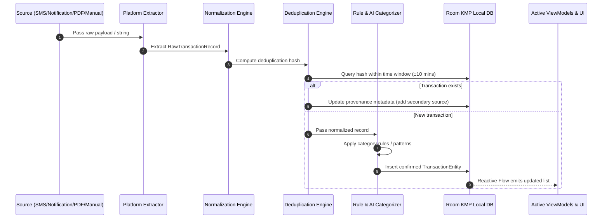
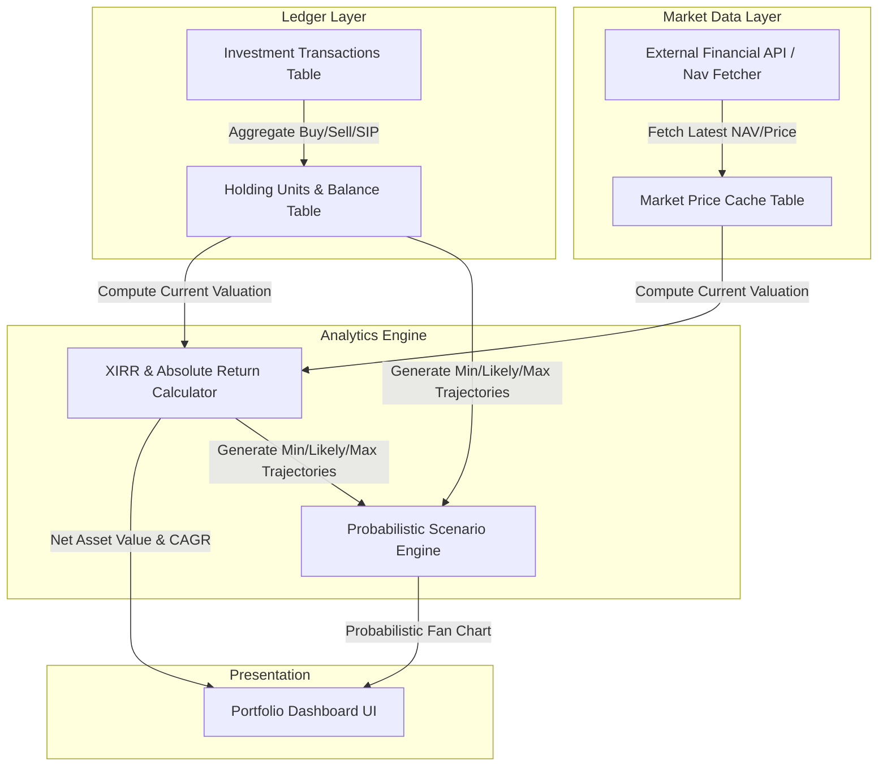
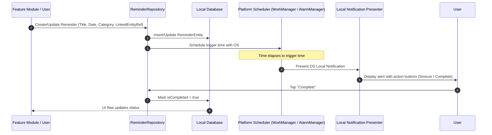
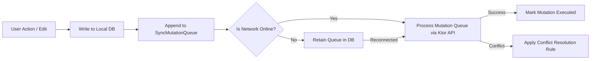

# AnixLifeTracker - Data Flow & Pipeline Architecture

## 1. Multi-Source Financial Ingestion Pipeline

Financial transactions are captured from multiple disparate channels and converted into normalized accounting records.

### Deduplication Hash Strategy
To prevent duplicate records when an expense triggers both an SMS and a Push Notification, a deterministic deduplication hash is generated:

$$\text{Hash} = \text{SHA256}(\text{accountLast4} + \text{amountCents} + \text{transactionType} + \text{dateBucket(10 min)} + \text{normalizedMerchant})$$

If a hash match occurs within a 10-minute time window, the ingestion engine treats the new payload as a secondary source confirmation rather than a new transaction.

---

## 2. Investment & Portfolio Tracking Flow

The investment engine manages asset holdings, calculates return metrics, and projects future wealth trajectories.

### Key Rules
- **Probabilistic Projections**: Projections are calculated as range distributions (e.g., 8% Bear, 12% Expected, 15% Bull) and presented with explicit disclosures that market returns are not guaranteed.
- **Exact Accounting**: Unit quantities and NAV prices are stored with 6-decimal precision (`unitsMicro: Long` or high-precision fixed point) to eliminate cumulative rounding drift.

---

## 3. Universal Reminder Engine Flow

Reminders operate across financial, travel, personal, and AI alert domains using a unified state flow.

---

## 4. Sync Metadata & Offline Mutation Queue Flow

When cloud synchronization is enabled (Plan 4+), mutations follow an offline-first transactional queue:

### Conflict Resolution Strategy
- **Client Wins for Local User Edits**: Direct manual edits by the primary user override background inferences.
- **Timestamp Versioning**: Entities track `lastModifiedTimestamp` and `version: Long`. Server reconciliation uses Last-Write-Wins (LWW) with server-side validation.
