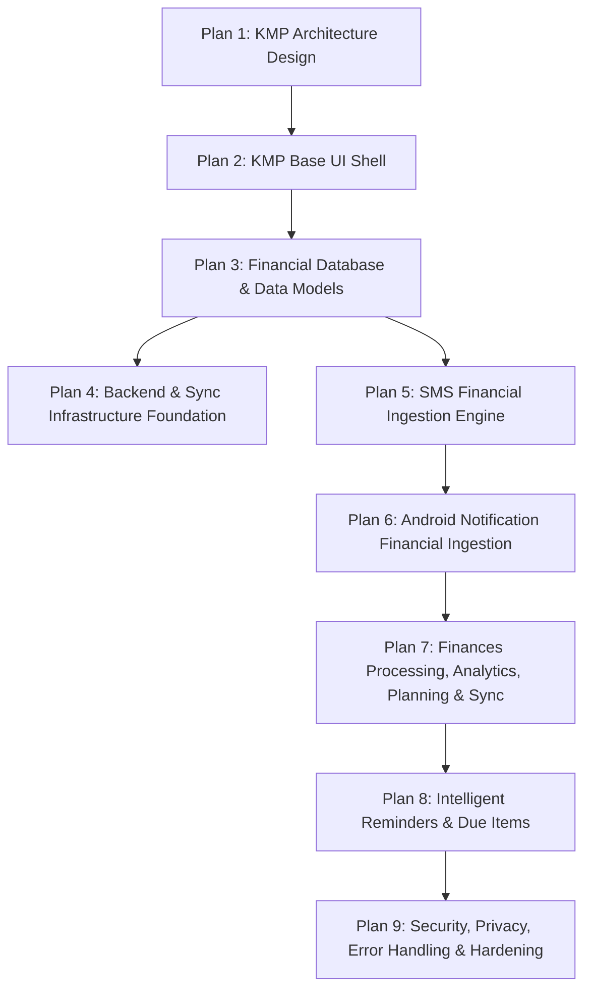

# AnixLifeTracker - Feature Implementation Roadmap

## 1. Revised Sequence & Roadmap Overview

The development of AnixLifeTracker is structured into the consolidated plan sequence.

---

## 2. Plan Descriptions

- **Plan 1: KMP Architecture & Structure Design** *(Completed)*
- **Plan 2: KMP Foundation & Base UI Shell** *(Completed)*
- **Plan 3: Financial Database & Data Models** *(Completed)*
- **Plan 4: Backend & Sync Infrastructure Architectural Foundation** *(Completed)*
- **Plan 5: Financial Ingestion Engine (SMS)** *(Completed)*
- **Plan 6: Notification-Based Financial Ingestion** *(Completed)*
- **Plan 7: Finances Processing, Analytics, Planning & Sync Adjustment** *(Completed)*
  - **Goal**: Implement shared transaction processing pipeline, deduplication, reconciliation, accounting rules, review queue, analytics, budgets, recurring obligations, forecasts, unusual spending detection, and updated cross-platform sync policy.
- **Plan 8: Intelligent Reminders & Notification Engine** *(Pending)*
  - **Goal**: Implement reminder management, due-item generation, and notification delivery infrastructure (with delivery disabled initially).
- **Plan 9: Security, Privacy, Error Handling & Hardening** *(Pending)*
  - **Goal**: Integrate SQLCipher encryption, permissions, privacy controls, error handling, and performance hardening.
