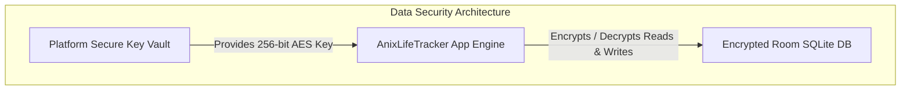

# AnixLifeTracker - Security & Privacy Architecture

## 1. Threat Model & Classification

Financial data, account details, personal transaction histories, and reminders are classified as **Strictly Confidential Personal Data**.

### Threat Matrix & Mitigation Strategies

| Threat Domain | Potential Risk | Architectural Mitigation |
| :--- | :--- | :--- |
| **Local Storage Compromise** | Unauthorized app or device access reading Room SQLite database file | Local database file encrypted at rest via SQLCipher / Encrypted SQLite with key stored in OS KeyStore |
| **Over-permission Escalation** | Malicious intent or leak via Android SMS / Notification access | Strict least-privilege permission requests; SMS/Notification contents filtered in-memory immediately and never logged |
| **Credential Theft** | Exposure of sync auth tokens or API credentials | Credentials stored exclusively in Android KeyStore, JVM Keyring (SecretService / KeyChain), or Web Crypto API |
| **Data Leakage in Logs** | Transaction amounts or bank account numbers output to log files / Logcat | Automated `RedactingLogger` stripping account numbers, amounts, and personal names before console output |
| **Man-In-The-Middle (MITM)** | Interception of cross-device sync traffic | TLS 1.3 enforced for all Ktor API connections; Certificate Pinning enabled for production sync servers |
| **Cloud Provider Trust** | Unencrypted financial data stored on cloud servers | Owner-scoped Row Level Security (`owner_id`) + Zero-Knowledge normalized record storage |

---

## 2. Permission Hygiene & Consent Model

### Android Runtime Permissions & Special Access
1. **`RECEIVE_SMS` / `READ_SMS`**:
   - Explicit user opt-in required via an onboarding dialog explaining why SMS access is used.
   - Processing is restricted purely to financial institution senders (e.g., bank shortcodes/headers). Personal SMS messages and OTPs are ignored and discarded at the system filter level.
2. **`BIND_NOTIFICATION_LISTENER_SERVICE`**:
   - Special user-granted setting required to read payment alerts from selected banking apps.
   - Consent dialog and explicit app allowlisting required before any notification is processed.
   - Default state monitors 0 apps. Non-financial notifications and OTPs are dropped immediately without storing or uploading.
3. **`POST_NOTIFICATIONS`**:
   - Reserved for local reminder alerts. Outgoing remote delivery remains disabled.

---

## 3. Storage Security & Encryption Strategy



### Encryption Specifications
- **Database at Rest**: Room SQLite database encrypted using 256-bit AES via SQLCipher / Encrypted SQLite.
- **Encryption Key Management**:
  - **Android**: Hardware-backed KeyStore (`KeyGenParameterSpec.PURPOSE_ENCRYPT | PURPOSE_DECRYPT`).
  - **Desktop JVM**: Master key derived using OS native credential manager or PBKDF2 with per-vault salt.
  - **Web (WasmJS)**: Key stored in Web Crypto `SubtleCrypto` unexportable KeyStore.

---

## 4. Sensitive Data Minimization & Log Redaction

- **No Raw SMS Retention**: Raw SMS bodies and notification texts are discarded immediately after extraction into normalized transaction records. Security OTPs are dropped prior to parsing.
- **Log Redaction Rules**: All application logs pass through `RedactingLogger`:

```kotlin
// RedactingLogger invariant
fun redact(message: String): String {
    return message
        .replace(Regex("\\b\\d{10,16}\\b"), "[REDACTED_ACCOUNT]")
        .replace(Regex("(?i)(rs\\.?|INR|\\$)\\s*\\d+([.,]\\d+)?"), "[REDACTED_AMOUNT]")
        .replace(Regex("(?i)(jwt_\\w+|bearer\\s+[a-zA-Z0-9._-]+)"), "[REDACTED_SENSITIVE]")
}
```

---

## 5. User Data Control & Destruction Workflows

- **Local Cache Clearance**: Purges in-memory caches and temporary review candidate items.
- **Purge Local Data**: Erases local SQLite database tables for the active user owner.
- **Wipe Cloud Data**: Issues cloud data wipe request and increments dataset generation version.
- **Delete Account & Data**: Complete server wipe + local database deletion + session clear.
